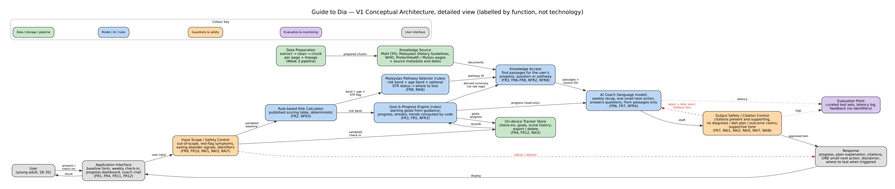

# Guide to Dia — AI Assistant for Type 2 Diabetes Risk Awareness

Guide to Dia helps young adults in Malaysia understand their type 2 diabetes risk: a transparent rule-based calculator works out the score, and a retrieval-grounded AI explains it in simple words, cites official health documents, and gives one clear next step. It is a screening-awareness aid. It does not diagnose diabetes, interpret lab results, or recommend treatment.

## Problem Statement
Many young adults in Malaysia do not know they may be at risk of type 2 diabetes. Existing calculators return a score and category but do not explain why a factor matters or what to do next, and clinical wording such as "first-degree relative" can put people off finishing. General-purpose chatbots can explain but may invent medical facts. Guide to Dia uses retrieval, citation checking and safety guardrails so the explanation is both understandable and traceable to official sources.

## Evidence of the Problem
- About 50% of people with diabetes are undiagnosed (MOH et al., Clinical Practice Guidelines: Management of T2DM, 6th ed., Dec 2020, Quick Reference Guide). NHMS 2023 reportedly found about 84% of adults aged 18–29 with diabetes were undiagnosed (The Star, 2 Aug 2025, quoting the MOH; verify against the original report).
- Malaysian guidance recommends risk-based screening of asymptomatic adults from age 30, earlier with risk factors, so under-30s depend on knowing their own risk factors (CPG 6th ed. Quick Reference Guide; The Star, 28 Oct 2026).
- Hypothesis H1 (to be validated, not yet evidence): young adults find a bare score hard to act on. A short usability check with 5–10 target users is planned.

## Initial Related Work / Existing Approaches
- **MyDiabeticRisk** (Ab Zayin et al., Zulfaqar J. Defence Sci. Eng. Technol. 6(2), 2023): logistic regression on glucose, blood pressure, BMI and age. Needs clinical measurements most young adults lack, and gives a prediction without cited explanation (as described in the paper).
- **ModAsian FINDRISC** (Lim et al., Prim. Care Diabetes 14(5), 2020, Malaysian primary care; Doan et al., J. Multidiscip. Healthc. 16, 2023, Vietnam adults ≥ 25): self-reported questionnaire with Asian BMI/waist cut-offs. Returns a score and category only; validity for ages 18–24 is not established.
- **CDC/ADA Prediabetes Risk Test**: 7-question self-test for US adults and prediabetes. Not aligned to Malaysian guidance and offers no personalised explanation.
- **General-purpose AI chatbots**: flexible explanations but may hallucinate, with no guaranteed citation or scope control.

## Engineering Gap / Limitation
No reviewed approach combines a transparent deterministic risk calculation with plain-language explanations grounded in, and cited to, official health documents, under explicit medical-safety guardrails. This is a practical engineering gap and not a claim of scientific novelty.

## Project Objectives
- **O1:** To design a hybrid assistant that calculates diabetes risk with a rule-based calculator and explains it in simple language using official health documents.
- **O2:** To develop it with retrieval, source citation and strict medical-safety guardrails.
- **O3:** To evaluate groundedness, safety, readability and response time.

## Target Users
Young adults aged 18–35 in Malaysia, mainly university students and early-career professionals, with no prior diabetes diagnosis.

## Application Scope
**Supported tasks:** answer plain-language risk-factor questions, compute a risk score and category, explain why each factor matters, show source references, give one next step, explain medical terms, and say when the documents do not contain enough evidence.

**Out of scope:** diagnosis; interpreting personal lab values; medication, insulin, supplement or diet-plan advice; type 1 diabetes; pregnancy/gestational diabetes; users under 18; emergency triage beyond "seek medical care promptly"; storing identifiable data.

## Main Features
- Plain-language risk questionnaire with "what does this mean?" help
- Deterministic rule-based risk calculator (the language model never changes the score)
- Simplified explanations grounded in retrieved official documents
- Source references for document-derived statements
- Exactly one next step matched to the risk category
- Abstention when evidence is insufficient
- Refusal and redirect for out-of-scope requests and red-flag symptoms

## Data Sources
- S01: MOH et al., Clinical Practice Guidelines: Management of Type 2 Diabetes Mellitus, 6th ed. (Dec 2020) — https://www.moh.gov.my (exact PDF URL to be recorded)
- S02: WHO, Diabetes fact sheet — https://www.who.int/news-room/fact-sheets/detail/diabetes
- S03: CDC/ADA, Prediabetes Risk Test (about page) — https://www.cdc.gov/prediabetes/risktest/about-the-test.html
- Calculator specification (rules, not retrieved text): Lim et al. 2020, ModAsian FINDRISC — doi:10.1016/j.pcd.2020.02.008

Redistribution rights are not yet verified, so source PDFs and chunk text are git-ignored; manifests (URL, date, SHA-256) are committed instead.

## Requirements Summary
Full details are in `docs/week2_requirements.md`.

| Type | IDs | Focus |
|------|-----|-------|
| Functional | FR1–FR8 | Plain-language questions, deterministic score, explanation, citations, one next step, abstention, scope refusal and red-flag redirect, disclaimer |
| Non-functional | NFR1–NFR7 | Latency, groundedness, calculator correctness, readability, cost, maintainability, reliability |
| Responsible AI | RAI1–RAI5 | Safety/scope, grounding and citations, privacy, fairness/validity, alarming tone |

## Evaluation Plan
Full criteria are in `docs/week2_evaluation_criteria.md`. Thresholds are initial values, revisited after the first measurement.

| Criterion | Metric | Threshold |
|-----------|--------|-----------|
| Calculator correctness | Matching score and category | 100% |
| Explanation groundedness | Supported-claim rate; unsupported numeric thresholds | ≥ 90%; 0 |
| Citation presence and support | Presence; citation–source match | 100%; ≥ 95% |
| Out-of-scope refusal and red-flag redirect | Refusal-and-redirect rate; red-flag redirect rate | ≥ 95%; 100% |
| Plain-language clarity | Share of explanations at Flesch–Kincaid grade ≤ 8 | ≥ 90% |
| Response latency | p90 end-to-end; p90 calculator | ≤ 8,000 ms; ≤ 1,000 ms |

Test sets: ≥ 30 calculator test vectors, ≥ 40 scenarios for groundedness, ≥ 30 out-of-scope and ≥ 10 red-flag prompts, ≥ 15 unanswerable questions, ≥ 50 scenarios for latency.

## V1 Architecture

The V1 architecture starts from the simplest flow (User → Application → Language Model Service → Response) and adds components only where requirements need them: a separate rule-based calculator, a knowledge source with retrieval for grounding and citations, input and output safety controls, and an evaluation point. Decisions, trade-offs and the traceability matrix are in `docs/week2_architecture_decisions.md`.

## Technology Stack (Provisional)
Specific technologies will be selected in later topics. Current candidates:
- Python
- Streamlit
- Sentence Transformers
- FAISS or ChromaDB
- Large Language Model (LLM)
- Retrieval-Augmented Generation (RAG)

## Responsible AI
- Answer only from retrieved passages, show source references, and abstain when evidence is insufficient.
- Never diagnose or recommend treatment; state on every result that only a blood test can diagnose diabetes.
- Redirect red-flag symptoms to prompt medical care.
- Collect no names or identifiers, keep nothing beyond the session, and send only derived features to any external model API.
- Disclose the limits of validation for ages 18–24 and use sex-specific thresholds.
- Explain high-risk results calmly with one concrete next step.
- Record document titles, versions, URLs and checksums.

## Documentation
| File | Description |
|------|-------------|
| `docs/week1_project_scope.md` | Week 1 project scope |
| `docs/week1_observation_sheet.md` | Week 1 group observation sheet (to add) |
| `docs/week1_system_map.png` | Week 1 group system map (to add) |
| `docs/week2_requirements.md` | Framing, scope, functional, non-functional and Responsible AI requirements, open items |
| `docs/week2_evaluation_criteria.md` | Evaluation criteria table |
| `docs/week2_architecture_decisions.md` | Architecture needs, ADRs, traceability matrix |
| `docs/week2_architecture_v1.png` | V1 conceptual architecture diagram |
| `docs/week3_data_inventory.md` | Data sources, rights, versions, inspection evidence |
| `docs/week3_pipeline_decisions.md` | Part B comparison, configuration, stage contracts, ETL/batch decisions |
| `docs/week3_pipeline_diagram.png` | Executed V1 data pipeline with two failure points |
| `notebooks/week3_pipeline.ipynb` | Runnable V1 data pipeline notebook (PDF pathway) and Week 4 audit cells |
| `data/week3_manifest.json` | Part B lineage manifest (generated by the notebook) |
| `data/pipeline_v1/documents/pipeline_manifest.json` | Part C pipeline run manifest (generated by the notebook) |
| `docs/week4_data_quality_report.md` | Data quality and bias report with quality-gate decision |

## Weekly Progress
| Week | Focus | Deliverable | Status |
|------|-------|-------------|--------|
| W1 | Project scoping and GitHub setup | README and project scope | Scope complete; group observation sheet and system map to add |
| W2 | Requirements, evaluation planning, V1 architecture | Requirements, evaluation criteria, architecture, ADR, traceability | Complete (review open items) |
| W3 | Data inventory and V1 data pipeline | Notebook, inventory, diagram, decisions, manifests | In progress: run on real PDFs and fill results |
| W4 | Data quality and bias audit | Data quality report | In progress: numbers and decision pending the audit run |
