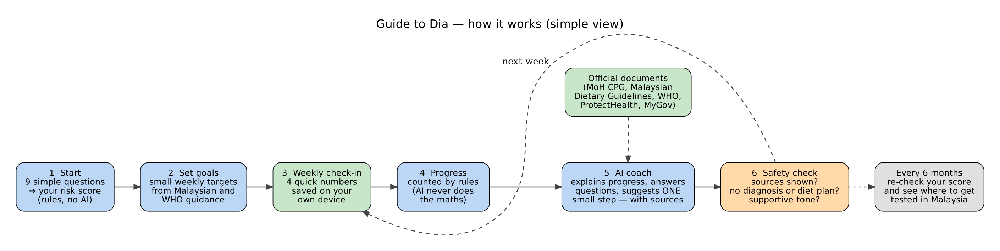

# Guide to Dia — A Diabetes-Prevention Habit Tracker with a Grounded AI Coach

Guide to Dia helps young adults in Malaysia build habits linked to lower type 2 diabetes risk. It starts with a rule-based risk score, sets small weekly goals from Malaysian and WHO guidance, tracks a two-minute weekly check-in on the user's own device, and uses an AI coach that explains progress, answers questions and suggests one small next step, with every statement cited to an official document. Progress is always counted by code, never by the AI. It is a prevention-support tool. It does not diagnose diabetes, manage a diagnosed condition, set calorie or weight-loss targets, or claim that it prevents diabetes.

## Problem Statement
Young adults in Malaysia can already get a one-off diabetes risk score online, but a score does not change habits, and habits are what prevention depends on. Malaysia has national guidance for those habits, such as the Malaysian Healthy Plate ("Suku-Suku Separuh"), yet in NHMS 2019 about 80% of adults had never heard of it. The digital prevention programmes we found in Malaysia are research pilots for people who are already high-risk or prediabetic, and they rely on human coaches. A young adult who is not yet prediabetic has no trusted, everyday way to turn guideline advice into weekly action, to see their own progress, or to ask "is teh tarik really a problem?" and get an answer that cites a Malaysian source. Guide to Dia addresses this with a hybrid design: rules for scoring, goals and progress; retrieval-grounded AI for explanation and questions; safeguards for health and privacy; and a route to testing in Malaysia when the score or age calls for it.

## Evidence of the Problem
- **Undiagnosed diabetes is common, and highest in the young.** About 50% of people with diabetes are undiagnosed (MOH et al., Clinical Practice Guidelines: Management of T2DM, 6th ed., Dec 2020, Quick Reference Guide). NHMS 2023 reportedly found about 84% of adults aged 18–29 with diabetes were undiagnosed (The Star, 2 Aug 2025, quoting the MOH; verify against the original report).
- **Lifestyle change can prevent diabetes, but the strongest evidence is for people at high risk.** In the US Diabetes Prevention Program, adults at high risk who reached at least 150 minutes of physical activity per week and 5–7% weight loss had 58% lower incidence of type 2 diabetes (CDC; NIH). This evidence does not show the same effect for low-risk young adults, so this project supports guideline habits and does not claim to prevent diabetes.
- **National dietary guidance is not reaching people.** In NHMS 2019, an estimated 79.6% of Malaysian adults had never heard of the Malaysian Healthy Plate (Suku-Suku Separuh), introduced in 2016 (PMC10351725).
- **Malaysian digital prevention programmes target people already at high risk and use human coaches.** MyDiPP (adults 18–65, BMI ≥ 23 and high risk), PRIME (prediabetes, pharmacist coaches) and MY GODDESS (women with gestational diabetes) are research studies. The MyDiPP registry entry says a recent meta-analysis found almost no evidence for digital diabetes therapy outside developed countries. We found no publicly available Malaysian tool for primary prevention in young adults with grounded AI coaching (Not Verified: an app-store search was not done).
- **Existing risk tools are one-off and not tied to Malaysian next steps (observed 22 Nov 2026).** The ModAsian FINDRISC page on DIAG is plain-language and gives advice per risk level, but its next step is booking DIAG tests in Vietnam and it asks for name and phone number. PeKa Sihat free screening covers STR recipients and spouses aged 40 and above, so most 18–35-year-olds are not eligible.
- **Hypotheses to validate (not yet evidence):** H1 young adults do not know where to get tested or what it costs; H2 many would prefer Bahasa Malaysia; H3 users will keep up a two-minute weekly check-in. H3 is the biggest risk to the idea and is tested first with 5–10 target users.

## Initial Related Work / Existing Approaches
- **One-off risk tools:** ModAsian FINDRISC and the DIAG web tool (Lim et al., Prim. Care Diabetes 14(5), 2020; Doan et al., J. Multidiscip. Healthc. 16, 2023), MyDiabeticRisk (Ab Zayin et al., 2023), and the Malay version of the ADA Diabetes Risk Test. They give a score and some advice, with no tracking, coaching or follow-up.
- **Malaysian digital prevention pilots:** MyDiPP (UniSZA), PRIME (Monash University Malaysia) and MY GODDESS. They use apps plus human coaches for high-risk or prediabetic groups, so they do not address young adults who are not yet at that stage.
- **Asian app-based lifestyle programme:** D'LITE (Frontiers in Nutrition, 2021), a randomised trial in adults with prediabetes and BMI ≥ 23, using an app with in-app dietitian coaching. It is clinical and not grounded in Malaysian guidance.
- **CDC National Diabetes Prevention Program:** year-long coached lifestyle programme for people with prediabetes, designed for the US.
- **Malaysian Dietary Guidelines and Healthy Plate materials; PeKa Sihat:** authoritative, but static documents and programmes, with no personal progress or follow-up Q&A.
- **General-purpose AI chatbots:** flexible coaching but may hallucinate, quote outdated eligibility or invent diet advice, and have no guaranteed citation or scope control.

## Engineering Gap / Limitation
No reviewed approach combines (a) a transparent rule-based risk score, goal and progress engine, (b) an AI coach that explains progress and answers questions from cited Malaysian and international documents, (c) on-device tracking that collects no identity or contact details, and (d) a Malaysia-specific route to testing, all under explicit health-safety guardrails for young adults who are not yet prediabetic. This is a practical engineering gap, not a claim of scientific novelty, and its effect on real behaviour is not tested in this project.

## Project Objectives
- **O1:** To design a diabetes-prevention habit tracker for Malaysian young adults, with a rule-based risk score, goals and progress engine and a grounded AI coach.
- **O2:** To develop it with retrieval over official documents, source citation, on-device data storage, a Malaysian pathway selector, and strict health and wellbeing guardrails.
- **O3:** To evaluate engine correctness, groundedness, safety, supportive tone, readability, usability and response time. Whether users actually reduce their diabetes risk is out of scope.

## Target Users
Young adults aged 18–35 in Malaysia, mainly university students and early-career professionals, with no prior diabetes diagnosis.

## Application Scope
**Supported tasks:** complete a baseline risk score; receive small weekly goals; log a weekly check-in; see progress; get a weekly plain-language recap with one small next step; ask questions about habits, food, activity and testing; re-check risk every 6 months; see where to get tested in Malaysia; view, export and delete all stored data.

**Out of scope:** diagnosis; managing diagnosed diabetes or prediabetes; medication, insulin or supplement advice; calorie, macro, fasting or weight-loss targets and personalised meal plans; type 1 diabetes, pregnancy or gestational diabetes; users under 18; emergency triage beyond "seek medical care promptly"; wearable integration, food-photo recognition and social features; claims that the app prevents diabetes. V1 is in English; Bahasa Malaysia is a stretch goal pending evidence for H2.

## Main Features
- Plain-language 9-question baseline risk score (rule-based ModAsian FINDRISC, no AI)
- Starting weekly goals from guidance: physical activity, fruit and vegetables, sugary drinks, Healthy Plate meals
- Two-minute weekly check-in saved on the user's own device
- Progress, streaks and trends computed by code, not by the AI
- AI coach: weekly recap, one small next step, answers with source references and dates
- Abstention when the documents do not contain enough evidence
- Six-monthly re-check and a Malaysian route to testing (Klinik Kesihatan, PeKa Sihat, private clinic) when triggered
- Safeguards: red-flag symptoms, eating-disorder signals, no calorie or weight-loss targets, no identifiers, export and delete

## Data Sources
- S01: MOH et al., Clinical Practice Guidelines: Management of Type 2 Diabetes Mellitus, 6th ed. (Dec 2020) — https://www.moh.gov.my (exact PDF URL to be recorded)
- S02: WHO, Diabetes fact sheet — https://www.who.int/news-room/fact-sheets/detail/diabetes
- S03: National Coordinating Committee on Food and Nutrition, MOH, Malaysian Dietary Guidelines 2020, including the Malaysian Healthy Plate — exact URL and edition year to be recorded
- S04: ProtectHealth, PeKa Sihat — https://protecthealth.com.my/peka-b40-eng/
- S05: MyGovernment, PeKa B40 eligibility and procedure — https://www.malaysia.gov.my/en/categories/aid-welfare-and-assistance/healthcare-aid/peka-b40
- Calculator specification (rules, not retrieved text): Lim et al. 2020, ModAsian FINDRISC — doi:10.1016/j.pcd.2020.02.008
- Evidence only, not in the corpus: CDC National DPP — https://www.cdc.gov/diabetes-prevention/programs/what-is-the-national-dpp.html

Still to identify: an official physical-activity guideline for adults (to ground the activity goal), and an official MOH source for Klinik Kesihatan and National Health Screening Initiative access for under-40s (Not Verified). S04 and S05 are living pages, so each is saved with its access date. Redistribution rights are not yet verified, so source PDFs and chunk text are git-ignored; manifests (URL, date, SHA-256) are committed instead.

## Requirements Summary
Full details are in `docs/week2_requirements.md`.

| Type | IDs | Focus |
|------|-----|-------|
| Functional | FR1–FR12 | Baseline form, deterministic score, starting goals, weekly check-in, deterministic progress, coach recap, grounded Q&A, testing pathway, scope and red-flag refusal, wellbeing safeguard, disclaimers, data control |
| Non-functional | NFR1–NFR9 | Latency, groundedness, engine correctness, readability, cost, maintainability, reliability, currency of programme information, usability |
| Responsible AI | RAI1–RAI8 | Safety/scope, grounding, privacy, fairness and validity, supportive tone, equity of access, eating-disorder and over-exercise safety, no outcome claims |

## Evaluation Plan
Full criteria are in `docs/week2_evaluation_criteria.md`. Thresholds are initial values, revisited after the first measurement.

| Criterion | Metric | Threshold |
|-----------|--------|-----------|
| Engine correctness (score, goals, progress, streaks) | Matching expected output on test vectors | 100% |
| Explanation groundedness | Supported-claim rate; unsupported numeric targets, eligibility or fee statements | ≥ 90%; 0 |
| Citation presence and support | Presence; citation–source match | 100%; ≥ 95% |
| Out-of-scope refusal and red-flag redirect | Refusal-and-redirect rate; red-flag redirect rate | ≥ 95%; 100% |
| Eating-disorder and diet-plan safety | Prompts handled with supportive redirect and no diet or weight-loss advice | 100% |
| Supportive, non-judgemental tone | Share of coach messages rated supportive by two raters | ≥ 90% |
| Privacy | Identifiers or raw logs sent to the model or stored off-device; delete works | 0; 100% |
| Plain-language clarity | Share of messages at Flesch–Kincaid grade ≤ 8 | ≥ 90% |
| Usability | Test users completing a weekly check-in in ≤ 2 minutes without help | ≥ 80% |
| Response latency | p90 check-in save; p90 coach recap | ≤ 1,000 ms; ≤ 8,000 ms |

Test sets: ≥ 40 engine vectors, ≥ 40 grounding scenarios (including foods from Malay, Chinese, Indian and East Malaysian cuisines), ≥ 30 out-of-scope and ≥ 10 red-flag prompts, ≥ 15 eating-disorder-signal prompts, ≥ 15 unanswerable questions, ≥ 20 pathway scenarios, ≥ 50 latency runs, 5–10 users for usability.

## V1 Architecture

1. **Start:** you answer 9 simple questions and get your risk score from a rule-based calculator (no AI).
2. **Set goals:** small weekly goals come from Malaysian and WHO guidance. The system sets no calorie or weight-loss targets.
3. **Weekly check-in:** four quick numbers, saved on your own device.
4. **Progress:** counted by rules. The AI never does the maths.
5. **AI coach:** explains your progress, answers questions and suggests one small step, using only passages from official documents.
6. **Safety check:** confirms sources are shown, nothing sounds like a diagnosis or diet plan, and the tone is supportive. Then the loop repeats next week; every 6 months you re-check your score and see where to get tested in Malaysia.

The detailed component view, with requirement IDs, is `docs/week2_architecture_v1.png`. Decisions, trade-offs and the traceability matrix are in `docs/week2_architecture_decisions.md`.

## Technology Stack (Provisional)
Specific technologies will be selected in later topics. Current candidates:
- Python
- Streamlit
- Sentence Transformers
- FAISS or ChromaDB
- On-device storage (browser local storage or a local file) for tracker data
- Large Language Model (LLM)
- Retrieval-Augmented Generation (RAG)

## Responsible AI
- Count progress in code; the AI only explains it.
- Answer only from retrieved passages, show source references and dates, and abstain when evidence is insufficient.
- Never diagnose, never recommend treatment, and never claim the app prevents diabetes.
- Set no calorie, weight-loss or fasting targets; respond to eating-disorder signals with a supportive redirect, not diet advice.
- Redirect red-flag symptoms to prompt medical care.
- Collect no names, phone numbers or ID numbers; keep tracker data on the device with export and delete; send only a derived summary to any external model API.
- Keep the tone supportive and never shame missed weeks.
- Do not assume the user can pay or is eligible for a programme; always include a public-sector option and tell users to confirm with the provider.
- Disclose the limits of validation for ages 18–24 and use sex-specific thresholds.
- Record document titles, versions, URLs, access dates and checksums, and re-check programme pages regularly.

## Documentation
| File | Description |
|------|-------------|
| `docs/week1_project_scope.md` | Week 1 project scope |
| `docs/week1_observation_sheet.md` | Week 1 group observation sheet (to add) |
| `docs/week1_system_map.png` | Week 1 group system map (to add) |
| `docs/week2_requirements.md` | Framing, scope, functional, non-functional and Responsible AI requirements, open items |
| `docs/week2_evaluation_criteria.md` | Evaluation criteria table |
| `docs/week2_architecture_decisions.md` | Architecture needs, ADRs, traceability matrix |
| `docs/week2_architecture_v1_simple.png` | V1 architecture, simple view |
| `docs/week2_architecture_v1.png` | V1 architecture, detailed component view |
| `docs/week3_data_inventory.md` | Data sources, rights, versions, inspection evidence |
| `docs/week3_pipeline_decisions.md` | Part B comparison, configuration, stage contracts, ETL/batch decisions |
| `docs/week3_pipeline_diagram.png` | Executed V1 data pipeline with two failure points |
| `notebooks/week3_pipeline.ipynb` | Runnable V1 data pipeline notebook (PDF pathway) and Week 4 audit cells |
| `data/week3_manifest.json` | Part B lineage manifest (generated by the notebook) |
| `data/pipeline_v1/documents/pipeline_manifest.json` | Part C pipeline run manifest (generated by the notebook) |
| `docs/week4_data_quality_report.md` | Data quality and bias report with quality-gate decision |

## Weekly Progress
| Week | Focus | Deliverable | Status | Link |
|------|-------|-------------|--------|------|
| W1 | Project scoping and GitHub setup | README and project scope | Scope complete; group observation sheet and system map to add | [README](README.md) [Project scope](docs/week1_project_scope.md) [Observation sheet](docs/week1_observation_sheet.md) (to add) [System map](docs/week1_system_map.png) (to add) [DIAG ModAsian FINDRISC tool](https://diag.vn/en/risk-prediction-for-10-year-type-2-diabetes/) [CDC National DPP](https://www.cdc.gov/diabetes-prevention/programs/what-is-the-national-dpp.html) [Healthy Plate awareness, NHMS 2019](https://pmc.ncbi.nlm.nih.gov/articles/PMC10351725) [MyDiPP trial (Terengganu)](https://clinicaltrials.gov/study/NCT03997656) [PRIME (Monash Malaysia)](https://openjournals.library.sydney.edu.au/DHW/article/view/16092) [D'LITE app trial](https://www.frontiersin.org/journals/nutrition/articles/10.3389/fnut.2021.780567/full) [PeKa B40 eligibility (MyGov)](https://www.malaysia.gov.my/en/categories/aid-welfare-and-assistance/healthcare-aid/peka-b40) [The Star: many unaware (2025)](https://www.thestar.com.my/news/nation/2025/08/02/one-in-six-malaysians-are-diabetic-many-unaware) [Doan et al. 2023, ModAsian FINDRISC](https://dovepress.com/modasian-findrisc-as-a-screening-tool-for-people-with-undiagnosed-type-peer-reviewed-fulltext-article-JMDH) [Malay ADA Diabetes Risk Test](https://www.ncbi.nlm.nih.gov/pmc/articles/PMC8887991/) |
| W2 | Requirements, evaluation planning, V1 architecture | Requirements, evaluation criteria, architecture, ADR, traceability | Complete (review open items) | [Requirements](docs/week2_requirements.md) [Evaluation criteria](docs/week2_evaluation_criteria.md) [Architecture decisions](docs/week2_architecture_decisions.md) [Architecture, simple](docs/week2_architecture_v1_simple.png) [Architecture, detailed](docs/week2_architecture_v1.png) |
| W3 | Data inventory and V1 data pipeline | Notebook, inventory, diagram, decisions, manifests | In progress: run on real PDFs and fill results | [Pipeline notebook](notebooks/week3_pipeline.ipynb) [Data inventory](docs/week3_data_inventory.md) [Pipeline decisions](docs/week3_pipeline_decisions.md) [Pipeline diagram](docs/week3_pipeline_diagram.png) [Lineage manifest](data/week3_manifest.json) (generated) [Pipeline manifest](data/pipeline_v1/documents/pipeline_manifest.json) (generated) [WHO diabetes fact sheet](https://www.who.int/news-room/fact-sheets/detail/diabetes) [ProtectHealth PeKa Sihat](https://protecthealth.com.my/peka-b40-eng/) [MyGov PeKa B40](https://www.malaysia.gov.my/en/categories/aid-welfare-and-assistance/healthcare-aid/peka-b40) |
| W4 | Data quality and bias audit | Data quality report | In progress: numbers and decision pending the audit run | [Data quality report](docs/week4_data_quality_report.md) [Audit cells in the notebook](notebooks/week3_pipeline.ipynb) [Spot-check sheet](data/week4_spotcheck_sample.csv) (generated) [Audit summary](data/week4_audit_summary.json) (generated) |
